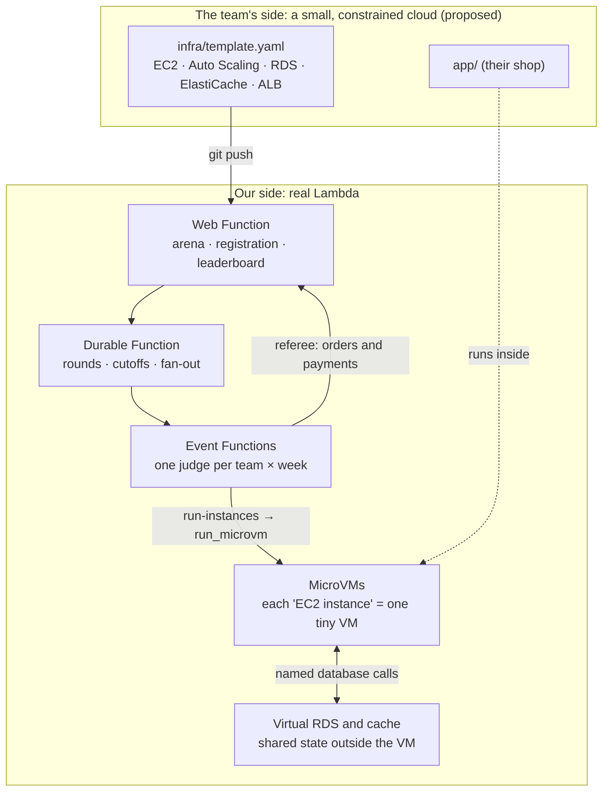
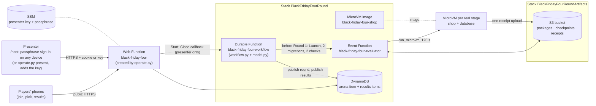
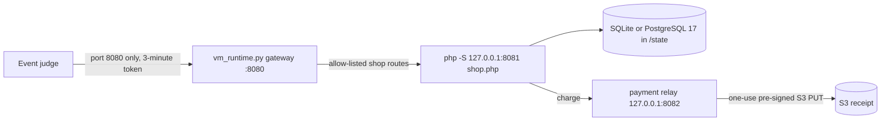
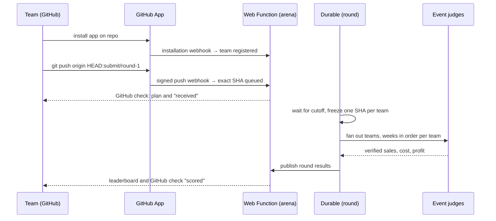
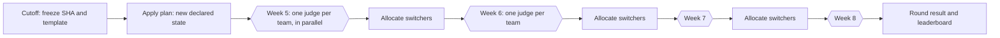

# BLACK FRIDAY architecture

BLACK FRIDAY has two sides:

- **The team's side** is a small, constrained cloud. A team declares instances,
  a database, a cache and a load balancer, then scales them within the rules.
- **Our side** is real AWS Lambda. It turns each declared instance into a tiny
  disposable MicroVM, judges the shop, and scales the judging to every team.

The teams scale the shop. We scale the judging.

Each section says what is **built and run** and what is **proposed**. Commands
for the built parts are in [`processes/`](processes/README.md); the game rules
are in [`game.md`](game.md).



## Scalable but constrained

| | Scalable | Constrained, and who enforces it |
|:--|:--|:--|
| **Team side** | More instances, Auto Scaling, a bigger database, a cache | Allowed resource types only (template checker). Fixed instance sizes. Every resource costs game money (judge's price list). |
| **Each tiny VM** | Boots in seconds; one VM per instance | Fixed memory and CPU. Destroyed after 120 s. No AWS role. Inbound only from the judge with a short-lived token. Outbound internet must be off before running outside code. |
| **Our side** | Durable fans Event judges out in parallel | Caps on concurrent judges, attempts and round length. A separate AWS account for team code. |

The constraints make the game fair (everyone gets the same tiny cloud), safe
(strangers' code is walled in) and cheap (we pay only while a VM runs).

## Our side today: built and run

Everything runs in Sydney (`ap-southeast-2`) on Lambda, S3, DynamoDB and SSM; it
was built and measured in Oregon (`us-west-2`) first. There is no real EC2, RDS,
load balancer, VPC or NAT gateway. The team's side of the built game is not a
cloud at all: each player picks options, and [`model.py`](../demo/aws/model.py)
computes the shop (see [game.md](game.md#economics)).

One deployment is live: the **four-round game** (`fourround`), with no shared
resources besides the presenter key and passphrase (selected by
`BLACK_FRIDAY_DEPLOYMENT`). Two earlier deployments of the same shape were
destroyed on 25 November 2026, artifacts buckets kept, and are redeployed from
their tags: the one-round **round** (`round-fallback-2026-11-25`) and the
**rehearsal**, the IAM-only predecessor of both
(`rehearsal-fallback-2026-11-24b`). The `fourround` build presented at the talk
is tagged `fourround-talk-2026-11-25`. The four-round game:



| Resource | Kind | Job | Limits |
|:--|:--|:--|:--|
| `black-friday-four` ([`operate.py`](../demo/aws/operate.py), [`web.mjs`](../demo/aws/web.mjs), player rules in [`game.mjs`](../demo/aws/game.mjs), conditional roster writes in [`roster.mjs`](../demo/aws/roster.mjs)) | Web Function, Node.js 24 | Player page, presenter page, API | Public endpoint (`ApplicationManaged`); presenter routes need a sign-in cookie or the SSM key; 10 failed sign-ins per 10 minutes; 2 KiB bodies; at most 10 environments, 100 requests/s, 8 concurrent requests per environment, 15 s timeout; request logs kept 7 days; HSTS; a 270 KB hero image cached for an hour |
| `black-friday-four-workflow` ([`workflow.py`](../demo/aws/workflow.py)) | Durable Function | The real Launch, migrations and checks, then for each of four rounds: wait for Close → plan (market, bots, dice) → score → publish results | 48 h execution, 23 h callbacks, 7-day history; at most five MicroVMs per game, none after Round 1 opens |
| `black-friday-four-evaluator` ([`evaluator.py`](../demo/aws/evaluator.py)) | Event Function | Starts a MicroVM for one real stage (`launch`, `migrate` or `compare`, careful or fast), drives the shop, checks the order, payment and saved cart, saves the result | 512 MB, 300 s, at most 10 at once |
| `black-friday-four-shop` | MicroVM image | PHP shop with SQLite or PostgreSQL 17 | ARM64, 1 GiB; each VM at most 120 s, no role |
| Arena table | DynamoDB, on demand | The arena item (roster, phase, callback), one immutable results item per round, the sign-in throttle, the timeline | 100 audience players; each item is small against the 400 KB item limit |
| Artifacts ([`artifacts.yaml`](../demo/aws/artifacts.yaml)) | S3, versioned | Code packages, checkpoints between stages, payment receipts | `runs/` objects expire after 7 days (old versions after 1 day); code packages are kept |

`round` and `rehearsal` had the same shape with their own names:
`BlackFridayRound`, `black-friday-round` and `black-friday-round-evaluator`;
`BlackFridayRehearsal`, `black-friday-arena` and `black-friday-evaluator` (at most
4 at once) with an IAM-only endpoint that `present` signs with SigV4. Each is
deployed from its own tag; on this branch one template
([`rehearsal.yaml`](../demo/aws/rehearsal.yaml), named for history) and one
artifacts template serve `fourround`, parameterised by the Web Function's name.

The launch-wave proof ([`launch-wave.yaml`](../demo/aws/launch-wave.yaml))
creates a temporary stack with its own Durable Function and Event judges (512 MB,
at most 8 at once), runs, and deletes it. Those judges run the trusted shop and
referee inside the function, with no MicroVM. That stack produced the measured
147 s → 22.6 s result ([`processes/launch-wave.md`](processes/launch-wave.md)).

Managed Instances is not deployed and was not measured. The Christmas `commit`
option is priced like it in `model.py`; that price is modelled.

## The tiny VM: built and run

There are two images.

**Game image** ([`Microvm.Dockerfile`](../demo/aws/Microvm.Dockerfile)), used by
every deployment: Debian trixie with PHP 8.4, PostgreSQL 17 and Python 3,
running as `postgres`.



- The gateway ([`vm_runtime.py`](../demo/aws/vm_runtime.py)) serves `/ready`,
  a single-use `/control/setup` (launch, migrate or compare; keep or drop data),
  `/control/artifact` (SQLite file or PostgreSQL dump), `/control/log` (the VM's
  last 500 log entries: the judge reads them before terminating the VM, because
  RunMicrovm logging needs a role the VM must not have), and a fixed list of shop
  routes. Everything else is 404.
- The shop holds no payment credential. The relay accepts only the checkout the
  judge expects and writes one receipt through a link that expires with the VM.
- Each stage gets a fresh VM. Only the exported artifact carries data forward.

**Submission image** ([`Submission.Dockerfile`](../demo/aws/Submission.Dockerfile)):
PHP 8.4 CLI as `nobody`, serving the reviewed fixture's `/ready` and
`/quote?quantity=N`. A frozen Git commit of that fixture ran in a real Oregon
MicroVM and earned 82 sales × $25 = $2,050.

**Outbound internet is on** in both images (`INTERNET_EGRESS`). That is
acceptable for reviewed code and must change before running anyone else's; see
[`processes/running-outside-code.md`](processes/running-outside-code.md).

### Why a MicroVM for the team's shop

- A separate kernel per shop, so hostile code stays in its own VM.
- No execution role, so no AWS credentials; the judge alone can reach port 8080.
- Any language and any OS packages, including the team's own database process.
- A fresh VM per stage: nothing survives to influence the next round or another team.
- The same size and a hard time limit for everyone.
- Real execution, so a slow query is slow and a crash loses the sale.
- Billed only while running, unlike an EC2 instance per team.

## Fake AWS for teams: built and run

Two fake EC2 APIs accept the stock `aws` CLI on a loopback endpoint. Neither
creates a real EC2 instance.

| | Local simulator ([`simulator.py`](../demo/simulator.py)) | Pseudo-EC2 bridge ([`pseudo_ec2.py`](../demo/aws/pseudo_ec2.py)) |
|:--|:--|:--|
| An "instance" is | A PHP shop process in one local container | A real Lambda MicroVM |
| AWS account | Not needed | Needed |
| Operations | 12 (below) | `describe-images`, `run-instances` (one `t4g.micro`), `describe-instances`, `terminate-instances` |
| Use | Practising infrastructure changes | Showing `run-instances` boot an isolated VM from one reviewed commit |

Local simulator operations:

| Service | Operations | Limits |
|:--|:--|:--|
| EC2 | `run-instances`, `describe-instances`, `terminate-instances` | `ami-00000000000000001`, `t4g.micro`, at most 4 running; client-token idempotency; the `BlackFridayDatabase` tag attaches a database |
| RDS | `create-db-instance`, `describe-db-instances`, `delete-db-instance` | `db.t4g.micro` PostgreSQL, at most 4, on one local PostgreSQL server; delete needs `--skip-final-snapshot` and is refused while in use |
| Load balancer | `create-load-balancer`, `create-target-group`, `create-listener`, `register-targets`, `deregister-targets`, `describe-target-health` | One load balancer on `127.0.0.1:8781`; checks `/health` and alternates healthy targets |

An instance without the database tag keeps its data in its own SQLite file, which
is lost on termination. Commands: [`processes/local-aws-simulator.md`](processes/local-aws-simulator.md).

## Virtual RDS: built and run

[`virtual_rds.py`](../demo/virtual_rds.py) is an in-memory store that makes the
database a deliberate, repeatable bottleneck:

- A read costs 1 unit and a commit 2. Small handles 80 units/s, large 160. A
  request that would wait more than 1 s is rejected with HTTP 429.
- `conditional_commit` checks and writes in one step, so orders are exactly once.
- A fault can drop the reply to a successful commit, testing whether a retry
  charges twice. The referee counts payments separately.
- Shared storage survives shop replacement; the `local` tier dies with the shop.
- The same seed gives the same result anywhere, so the leaderboard is fair.
- No server to start, so one Event judge scores a design in about 5 s.

It models capacity and timing; it does not measure a real database. Only the
trusted Python test shop uses it today. The AWS game does not use it: its rounds
are scored by [`model.py`](../demo/aws/model.py).

## The Durable game and its items

One Durable execution runs one game ([`workflow.py`](../demo/aws/workflow.py),
event `{id: <run id>}`). Every operation name is unique and round-scoped.

1. `register-execution`: records the execution ARN against the run.
2. `launch-shop`: invokes the evaluator with `launch`. A failure becomes
   recorded Launch evidence.
3. `migrate-every-option` runs `migrate-careful` and `migrate-fast` in parallel;
   then `check-every-option` runs `compare-careful` and `compare-fast` (only for
   migrations that worked). An option whose migration or check fails uses its
   `recorded_evidence` from `rounds.json`; the other option is untouched (if
   Launch fails before saving its result, both migrations fail with "Missing
   prerequisite" and both options use recorded evidence).
4. For each round (`launch`, `growth`, `blackfriday`, `christmas`):
   `publish-open-<round>` sets the phase `open`, the round and the callback id
   (Launch also writes `launch_data` and `evidence_data`; later rounds write
   `results_round`, the round before); `await-close-<round>` waits for the Close
   callback (23 h; a timeout runs `expire-close-<round>` and ends the game as
   `expired`); `plan-<round>` draws the market, the bots and every player's roll
   and noise with `secrets.randbelow`; `score-<round>` runs `model.score`;
   `publish-results-<round>` writes the results item.
5. `publish-final` sets the phase `final` with `results_round` = `christmas`.

The callback value is `{action: 'close', round, players}` and the workflow
rejects a different round. Players, states, baseline and bots live only in
checkpointed step results (up to 256 KB per operation); the plan and score steps
are pure, so a replay returns the recorded draws. No MicroVM is created after
step 3.

DynamoDB, one on-demand table:

| Item (`pk`) | Fields |
|:--|:--|
| `arena` | `run_id`, `phase`, `round` (the round open or closing), `results_round`, `teams_data` (JSON roster: `id`, `name`, `house`, `token_hash`, `picks`), `frozen_data` (the roster as Close froze it), `callback_id`, `lease_until` (the Close retry lease), `execution_arn`, `workflow_arn`, `start_deadline`, `launch_data`, `evidence_data`, `expired_action` |
| `results#<run>#<round>` | `run_id`, `round`, `data` (JSON `{round, market, summary, rows}`); written once per round, never changed |
| `login` | The sign-in throttle: `window_start`, `failures` |
| `timeline#<run>` | `run_id`, `lines`: the presenter's "Behind the scenes" log, a list of JSON strings, one timeline item each (below), at most 300 per run |

**Timeline.** One item is `{id, t, tag, level, text, detail, log_group?}`: `t` is
epoch ms, `tag` is `DURABLE`, `MICROVM` or `WEB`, and `level` is `debug`, `info`,
`warn` or `error`. One constructor decides tag, level and log group together:
[`workflow.timeline_line`](../demo/aws/workflow.py) and `webLine` in
[`web.mjs`](../demo/aws/web.mjs). `DURABLE` is a decision the workflow recorded
(registered, round open, Close received, plan, score, results, final); recorded
evidence and expiry are `DURABLE` at `warn`; `MICROVM` is evidence that really
ran in a VM (Launch, careful, fast), with the evaluator's log group; `WEB` is a
presenter action (Reset is `warn`). Each line has a stable `id`, and each id
appears once in a normal game. The workflow writes `registered`, `launch`,
`migrate-<option>`, `compare-<option>` (in a `timeline-evidence` step after
step 3), `open-<round>`, and in `publish-results-<round>` `close-`, `plan-`,
`score-` and `results-<round>`, then `final` (or `expire-<round>` when a Close
times out). The Web Function writes
`web-reset` (into the new run), `web-start` and `web-close-<round>`. The workflow
writes only inside checkpointed steps, so a replay never repeats a line. Every
append is one `list_append` UpdateItem conditioned on fewer than 300 lines. A
failed write is logged and ignored, so the timeline can never stop a game.
`detail` keys come from a fixed list per line kind (durations, VM ids, execution
ARN, round, option, cart status, charges, market, players, picked, bots, best
option, leader); tokens, token hashes, cookies and callback ids are never
written. Only `GET /api/host/timeline` and the read-only logs function read it;
phones' `/api/state` never carries it.

Phases: `ready` → (Start) `starting` → `open` (Launch) → (Close) `closing` →
`open` (Growth) → … → `closing` → `final`. `expired` is set when the execution is not found within
90 s of Start, when a Close callback times out, or when Lambda reports the
execution `TIMED_OUT`; `failed` is not stored: the Web Function reports it when
Lambda says the execution `FAILED`, `STOPPED`, is `DELETING`, or `SUCCEEDED`
without a `final` phase. Reset replaces the arena item with a new `ready` run in
any phase. The workflow's writes name the run, the ARN and the previous phase, so
a stale execution cannot change a newer run.

A results row (about 360 bytes of JSON with a 20-character name, so about 37 KB
per round at 101 players, computed offline with `model.py`) carries `id`, `name`,
`house`, `bot`, `rank`, `option`, `roll`, `risk`, `hit`, `outcome` (`held`, `hit`
or `lost_carts`; the colour follows it, while `hit` is the dice alone), `event`,
`sales`, `slow`, `failed`, `cost_cents`, `refund_cents`, `profit_cents`,
`cumulative_cents`, `returning` and `evidence` (`real`, `recorded` or `modelled`).

## The logs function

`black-friday-four-logs` ([`logs_web.mjs`](../demo/aws/logs_web.mjs), event model
in [`logs.mjs`](../demo/aws/logs.mjs)) is a second Web Function beside the game,
in its own stack `BlackFridayFourRoundLogs`. Its role is read-only:
`dynamodb:GetItem` on the run table, `lambda:GetDurableExecution` and
`lambda:GetDurableExecutionHistory` on the workflow's executions,
`logs:FilterLogEvents` and `logs:StartLiveTail` on the game's four log groups,
and the two presenter SSM parameters. It writes nothing to the game, and its
package sits in its own bucket, so the game bucket's policy is unchanged.

It turns the timeline item, the Durable history and the CloudWatch lines into
one event stream `{id, ts, tag, level, source, text, detail}`. Ids are
deterministic (`tl:`, `du:`, and `cw:` plus a hash of group, timestamp and
message), so every environment, and Live Tail and FilterLogEvents alike, gives
the same id for the same line. Text and details are redacted again: signed or
payment URLs, 32-hex ids, token-, receipt- and cookie-shaped values. The status
bar counts players and picks without names. Running and signing in:
[aws-rehearsal.md](processes/aws-rehearsal.md#live-log-for-the-room-fourround);
what each tag means is in the table there.

### Log lines

One closed vocabulary runs from the producers to the viewer.

- **Tags** (eight): `DURABLE`, `WORKFLOW`, `EVENT`, `MICROVM`, `VM`, `PHP`, `WEB`
  and `WATCH` (the viewer's own status line; only the logs function emits it).
  There is no `GAME` or `ERROR` tag: an error is a level.
- **Levels**: `debug`, `info`, `warn`, `error`.
- **Evidence source**: `real`, `recorded`, `modelled`. The real-evidence options
  are read from `rounds.json` (`evidence: "real"`: growth `careful` and `fast`),
  never listed by hand.

Each producer prints one JSON object per line after a fixed prefix; nothing
parses free text, except the Web Function's `console.error` lines, which stay
free text.

| Producer | Line | Fields |
|:--|:--|:--|
| VM, [`vm_runtime.py`](../demo/aws/vm_runtime.py) buffer entry | one JSON object; `/control/log` returns `{"entries":[...]}` | `seq` (0-based, monotonic per VM), `t` (epoch ms), `kind` (`stage` or `php`), `level`, `run` (first 8 characters of the run id), `action` (`launch`, `migrate` or `compare`), `option` (`careful`, `fast` or null), `msg` (at most 200 characters, redacted before it is cut). A stage entry may carry `ms`. A `php` entry also carries `method`, `path` (no query string), `status` and `ms`. PHP's own stderr is a `stage` entry whose message starts `php:`. |
| Evaluator relay | `[VM] <json>` | Each valid VM entry unchanged, in `seq` order; an invalid one is dropped and counted in one `[EVENT]` warn line. Kind `php` becomes tag `PHP`, every other entry tag `VM`. |
| Evaluator | `[EVENT] <json>` | `t`, `level`, `action`, `option` (null for launch), `step` (`launch`, `migrate-careful`, …), `msg` and, for a timed step, `ms`. |
| Workflow | `[WORKFLOW] <json>` | `step`, `round` (or null), `level`, `msg`. Printed only inside checkpointed steps, so a replay never repeats one. |
| Timeline item | stored, not logged | `{t, id, tag, level, text, detail, log_group?}`, above. |
| Web access | `{"bf":"access",…}` | `level`, `method`, `route`, `status`, `ms` and optionally `phase`, `round`; `method`, `phase` and `round` come from closed sets. |

No entry carries a payment URL, receipt, token, signed URL, request body or
header. Examples:

```
{"seq":1,"t":1795585743478,"kind":"php","level":"info","run":"aaaaaaaa","action":"compare","option":"careful","msg":"GET /cart/cart-saved 404 12 ms","method":"GET","path":"/cart/cart-saved","status":404,"ms":12}
[WORKFLOW] {"step":"plan-growth","round":"growth","level":"info","msg":"market 18%, 0 bots, 2 players"}
{"t":1795585822599,"id":"compare-fast","tag":"DURABLE","level":"warn","text":"Fast migration check (recorded): fumbled, Maya's cart lost (404)","detail":{"cart_status":404,"charges":0,"option":"fast","source":"recorded"},"log_group":"/aws/lambda/bf-workflow"}
```

## The arena

**Today (built and run):** one Web Function ([`web.mjs`](../demo/aws/web.mjs),
rules in [`game.mjs`](../demo/aws/game.mjs)) serves two pages, both driven by
[`round.js`](../demo/aws/round.js).

- **Player page** ([`player.html`](../demo/aws/player.html), public): join with
  an optional name, rename until the Launch round closes, tap one of three
  options per round (greyed out with the reason when `requires` is not met), see
  the previous round's result and the board: the top 10 and the viewer's own row,
  with "+N more". A player token kept on the phone (`localStorage` key
  `black-friday-player`) guards its name and picks. Other players' picks are
  never in `/api/state`; before Close the roster carries nothing to a phone but
  the player's own picks, and the board comes from the round's results item.
- **Presenter page** ([`host.html`](../demo/aws/host.html)): the page is public
  but shows only a passphrase form until sign-in
  ([`host_auth.mjs`](../demo/aws/host_auth.mjs)). The passphrase is Rick's own
  (SSM SecureString, set with `operate.py passphrase`); the session cookie is an
  HMAC keyed by the SSM presenter key over the current passphrase, so changing
  either signs every device out. After sign-in: QR and public URL (and a full
  screen QR), the players with ticks for who has picked, Remove while joining is
  open, the round's forecast and market range, **Start**, **Close round N** and
  **Reset**, the market draw, a per-option summary of the last round, the board,
  the evidence, and the execution ARN; a "Behind the scenes" timeline drawer with
  tag filters and search; and an **Explanations** toggle for the callouts. Each
  action is bound to the current run (and Close to the open round), so a
  double-click cannot advance it twice. Only these actions start compute.
  `operate.py present` (presenter key header) remains as a second way in.

Routes and rules: [AWS game and rehearsal](processes/aws-rehearsal.md#what-runs).
The frozen rehearsal serves the older single presenter page,
[`demo/index.html`](../demo/index.html), which also runs locally from
[`arena.py`](../demo/arena.py).

**Proposed:** Git-registered teams, submissions and a multi-round leaderboard.



1. **Register:** create a repo from a starter template and install the BLACK
   FRIDAY GitHub App on it. The installation gives the repository's numeric ID
   and the installing user. An organiser approves team names before they appear.
2. **Practise:** a push to any other branch gets a one-scenario score as a GitHub
   check, rate limited per team.
3. **Submit:** the last push to `submit/round-N` received before the cutoff
   counts. [`submissions.py`](../demo/submissions.py) already implements
   signed webhooks, exact SHAs, receipt-time cutoff and frozen export; it would
   take teams from app installations instead of a config file.
4. **Leaderboard:** public, read-only: profit per round and in total, verified
   sales, lost carts, duplicate charges, and each team's drawn architecture.

A Web Function endpoint can be public (`ApplicationManaged`, used by the round),
so the webhook and leaderboard need no separate function.

## What teams submit: proposed

```
my-shop/
  app/                 # their shop: listens on :8080, implements the Shop API
  infra/template.yaml  # the architecture, in a CloudFormation subset
```

```yaml
Resources:
  Db:
    Type: AWS::RDS::DBInstance
    Properties: {Engine: postgres, DBInstanceClass: db.t4g.large, AllocatedStorage: 20}
  Cache:
    Type: AWS::ElastiCache::CacheCluster
    Properties: {Engine: redis, CacheNodeType: cache.t4g.micro, NumCacheNodes: 1}
  ShopA:
    Type: AWS::EC2::Instance
    Properties:
      InstanceType: t4g.small
      ImageId: blackfriday-app
      Tags: [{Key: DATABASE_URL, Value: !GetAtt Db.Endpoint.Address}]
  Targets:
    Type: AWS::ElasticLoadBalancingV2::TargetGroup
    Properties: {Port: 8080, HealthCheckPath: /health, Targets: [{Id: !Ref ShopA}]}
```

| Template resource | What we run | Game cost |
|:--|:--|:--|
| `AWS::EC2::Instance` (`t4g.micro/small/large`) | One MicroVM running `app/`; size sets memory and CPU | Per instance size |
| `AWS::AutoScaling::AutoScalingGroup` + launch template | The judge adds and removes MicroVMs during the week | Per running instance |
| `AWS::RDS::DBInstance` | A Virtual RDS store; class sets capacity | Per tier |
| `AWS::ElastiCache::CacheCluster` | A cache service outside the VM | Per node |
| `AWS::ElasticLoadBalancingV2::*` | Our load balancer | Fixed |
| `AWS::EC2::VPC`, `Subnet`, `SecurityGroup` | Accepted and ignored | Free |
| IAM, Lambda, custom resources, `Transform`, macros | Rejected at push | — |

Template functions: `Ref`, `GetAtt`, `Sub`, `Join`, `Parameters`. Database and
cache addresses reach the app as environment variables.

**CDK:** teams may use CDK locally but commit the synthesized template. The judge
never runs `cdk synth`, because that executes the team's code.

**Phases:**

1. **Template only.** Teams push `infra/template.yaml`; our reference shop runs
   on their architecture. No team code runs.
2. **Template and app.** Teams also push `app/`, once the hosted-runner controls
   and a database API exist (below).

## Managing state: proposed

There are three kinds of state. Only the first uses real CloudFormation.

| State | What it is | Where it lives | When it changes |
|:--|:--|:--|:--|
| **Our infrastructure** | Functions, MicroVM image, bucket, tables | Real CloudFormation stacks | When an organiser deploys |
| **Team's declared infrastructure** | Frozen template, plus one record per resource: type, settings fingerprint, our ID | S3 (template and plan, never overwritten) and DynamoDB (current pointer) | Once per round, at the cutoff |
| **Team's data and business** | Database contents, carts, orders, payments, returning customers, cumulative profit | S3 (one saved copy per week, named by checksum) and DynamoDB (index and scores) | After every simulated week |

**Resources are records; VMs exist only while running.** A team's two
`t4g.small` instances are two records. During an evaluation they become two
MicroVMs for at most 120 s, then disappear. We pay nothing while teams build.

### The plan: a mini CloudFormation

On every push:

1. **Check** allowed types and properties (`cfn-lint` plus our allowlist).
2. **Resolve** `Ref`, `GetAtt` and `Sub` into a resource graph.
3. **Compare** with the last frozen round and label each change:

| Change | Rule | Effect |
|:--|:--|:--|
| Instance size | Modify | New VM size next week |
| Auto Scaling min/max | Modify | Applies immediately |
| `DBInstanceClass` | Modify, brief downtime window | Capacity changes; requests fail during the window |
| `Engine`, or the database's logical ID | **Replace** | New, empty database unless the release migrates the data |
| Cache added or removed | Add / Remove | The cache always starts empty |
| Instance replaced | Replace | Anything stored on the instance is lost |

4. **Report** the plan as a GitHub check on the commit:

```
BLACK FRIDAY plan for submit/round-2 @ 3f9c1e2
  + Cache   ElastiCache cache.t4g.micro        +$12/week
  ~ Db      db.t4g.small → db.t4g.large        +$30/week, modify
  - ShopB   EC2 t4g.small                      −$8/week
  ! Db      Engine postgres → aurora: REPLACE  data will NOT carry over without a migration
```

Prices in this example are illustrative; the price list is not set.

### A round

Each week depends on the previous week's state, and with the
[switchers pool](design.md#the-switchers-pool) on every team's results
from that week. So the weeks run in order, and within each week the teams run in
parallel. Durable fans the teams out, waits for all of them, allocates the
switchers in a checkpointed step, then starts the next week.



Each team's week is one Event judge:

1. **Restore** last week's saved state: database contents, returning customers,
   the switchers allocated to this team, payment record.
2. **Boot** what the template declares: MicroVMs at the frozen commit, Virtual
   RDS loaded with the saved data, an empty cache, our load balancer.
3. **Play** the week's traffic; the referee checks every order and payment.
4. **Export** the database and destroy the VMs.
5. **Save** a new copy named by its checksum and record the score.

Durable saves progress after each week and after each allocation, so a failed
week 7 judge reruns from week 6 without changing anyone's switchers. A week
waits for its slowest team. If a team's judge still fails after its retry limit,
that team's week is scored as an outage (every checkout failed) and the round
moves on.

### Rules

- **Saved states are never overwritten.** The pointer moves only after the
  referee's result is recorded.
- **Reuse key:** commit, template checksum, scenario version, seed, starting state
  checksum, inbound switchers checksum and judge version. The same key gives the
  same result, so a retry reuses it rather than counting twice.
- **Practice runs** read official saved states and write only to a practice area.
- **One official timeline per team.** Extra seeds are for practice and robustness.

## Where the line sits

| Crosses between a team's VM and our side | Never crosses |
|:--|:--|
| HTTP from the judge to the shop, port 8080, short-lived token | AWS credentials (the VM has no role) |
| Named database calls to Virtual RDS (proposed) | The internet (once outbound access is off; proposed) |
| One payment receipt per checkout, through a one-use S3 link | Other teams' VMs and data |
| The exported database at the end of a stage | The referee's ledger and scores |

## Built vs to build

| Piece | Status |
|:--|:--|
| Our infrastructure as CloudFormation | Built |
| Durable game: real Launch and growth stages, then four modelled rounds; Event judges for the real stages | Built |
| MicroVM shop image, gateway, payment relay, checkpoints between stages | Built |
| Frozen commits from signed GitHub pushes | Built (`submissions.py`) |
| Local simulator and pseudo-EC2 bridge | Built |
| Virtual RDS with saved and restored state | Built (`virtual_rds.py run --checkpoint` / `resume`) |
| Template checker, resolver and plan | To build |
| Per-week loop and returning-customer state for submitted shops | To build (the built `model.py` steps per round, with returning customers as counts) |
| GitHub App registration, checks and public leaderboard | To build |
| Database API for team apps (named operations, hosted outside the VM) | To build; the hard part of phase 2 |
| Cache service outside the VM | To build |
| Hosted-runner controls: separate account, no outbound internet, isolated builds | To build before phase 2 |
