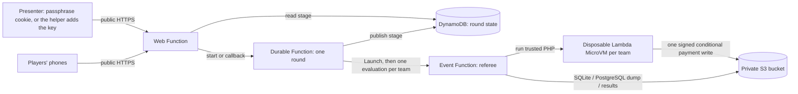

# AWS round and rehearsal

Two separate deployments run the same story in Sydney (`ap-southeast-2`):

| Deployment | Who plays | Endpoint | Presenter page |
|:--|:--|:--|:--|
| **round** | Everyone in the room (up to 200 teams) plus two house teams, and bots if the room is thin | Public (`ApplicationManaged`): players open it on their phones | <http://127.0.0.1:8768/host> |
| **rehearsal** | Nobody: the presenter compares two releases | IAM only | <http://127.0.0.1:8767/> |

Select one with `BLACK_FRIDAY_DEPLOYMENT=round` or `rehearsal` (the default).
They share no stacks, functions, tables or Web Function, so one can change or
be torn down without touching the other. The rehearsal is frozen at tag
`rehearsal-fallback-2026-11-24b`; the [local demo](local-play.md) needs no AWS
account and is the last fallback.

**The story.** In Launch, the unchanged PHP/SQLite shop sells a mug in a real
MicroVM and leaves Maya's cart saved, then the VM is terminated. Each team picks
one of three paths. Every path is really migrated from that same checkpoint to
PostgreSQL, once per path in use, in its own MicroVMs: at most three migrations
and three shopper checks however many teams play. Maya's cart survives in all of
them. What differs is the risk: when the round closes, every team rolls its own
dice, and a roll under its path's risk means the migration broke on Black Friday
and the shop earned nothing from the wave. The winner has the most profit after
the modelled AWS bill.

## What players do (round)

Nobody uploads code. A player makes one choice; only the organiser's code runs.

1. Scan the QR on the presenter page or slide and open the public URL.
2. **Join** with a team name: 1–20 printable characters, unique ignoring case.
   The phone keeps a team token; only that phone can change the team's pick.
3. **Pick** one of three big buttons before the round closes, and change it as
   often as they like. The options table is [`options.json`](../../demo/aws/options.json),
   the single source for the phones, the web function and the scoring:

   | Option | Shop | Breaks | Extra cost |
   |:--|:--|--:|--:|
   | **Lift & shift**: same code, same database | small shared database, 1 replica, no cache | 5% | none |
   | **Scale up**: bigger database | large shared database, 1 replica, no cache | 10% | +$40 |
   | **Refactor**: add a cache, fastest if it works | small shared database, 1 replica, cache | 30% | none |

4. Watch the scoreboard: the top 10 and their own row, with the roll behind
   it ("Held (rolled 63)" or "Broke on Black Friday (rolled 12, under 30)").

Other teams' picks stay hidden until the round closes. A team that joins but
never picks plays Lift & shift. **House A** plays Lift & shift and **House B**
plays Refactor. If fewer than six teams are in at Close, bots (Bot Lambo, Bot
Turbo, Bot Kevin, Bot Monolith, in that order) fill the board up to six, each
with a random option, and are labelled "bot"; their names are reserved so no
player can take one. Rolls and bot picks are drawn once, in one checkpointed
Durable step, so a replay never draws again.

Joining and picking are refused once the round closes, with the wrong team
token, and, as a safety cap on the roster item, past 200 teams ("The round is
full").

## What the presenter does (round)

**Sign in on the page itself.** Open `<public URL>/host` on a laptop or phone, no
helper and no Tailscale. The page is public but holds no secret: until you sign
in it shows only a passphrase form. After sign-in it shows the buttons, QR, team
list and execution ARN. The cookie is `__Host-bf_host` and lasts 12 hours
(`HttpOnly`, `Secure`, `SameSite=Strict`, `Path=/`, no `Domain`, so a sibling
subdomain cannot set or shadow it); **Sign out** clears it. When the page is
driven through the helper below there is no cookie, so Sign out is hidden.

Set your own passphrase once (at least 8 characters), before the talk:

```sh
cd demo
export BLACK_FRIDAY_AWS_ACCOUNT=<12-digit account id> BLACK_FRIDAY_AWS_PROFILE=<AWS CLI profile>
BLACK_FRIDAY_DEPLOYMENT=round uv run aws/operate.py passphrase
```

It asks twice with no echo (or reads one line from stdin when piped), stores it
as the SSM SecureString `/black-friday/round/presenter-passphrase`, and confirms
with the new parameter version, never the value. Console fallback: Systems
Manager → Parameter Store → `/black-friday/round/presenter-passphrase` → Edit →
SecureString value (at least 8 characters). Changing it signs every device out
within 30 seconds: each cookie is an HMAC over its expiry, keyed by the SSM
presenter key over the current passphrase, so neither secret is in it. Until a
passphrase exists, sign-in answers 503 and presenter routes stay 403.

Sign-in is throttled across all of the Web Function's environments: ten failed
attempts in ten minutes, then every sign-in gets 429 until the window passes.
Successful sign-ins do not count. Presenter POSTs also need the
`X-Rehearsal-Action: 1` header, the current run token and, when the browser sends
one, an `Origin` equal to the endpoint's own origin.

**The helper still works, as a second way in.** Either a valid cookie or the
presenter key authorises presenter routes:

```sh
BLACK_FRIDAY_DEPLOYMENT=round uv run aws/operate.py present --tailnet
```

`present` reads the presenter key from SSM (`/black-friday/round/presenter-key`)
and runs a loopback proxy at <http://127.0.0.1:8768/host> that adds it to every
request. The key never reaches a browser. (The key is also the MAC secret of the
cookie.)

`--tailnet` also publishes the presenter page at
`https://<this Mac's MagicDNS name>:8443/host`, so the presenter can drive the
round from a phone on the same tailnet. It runs `tailscale serve` (tailnet only,
not Funnel) in the foreground, so the page disappears when `present` stops; the
Mac must stay awake and online. A second loopback listener (port 8769) behind it
accepts only requests that `serve` marks with the Mac owner's login, so another
person on the tailnet or a tagged device gets 403, even where the tailnet policy
lets them reach the Mac. A process on the Mac itself is trusted, as it already
is for 8768. Without `--tailnet`, the page is on the laptop only.

The page shows the public URL as text and a QR code, the teams and whether they
have picked, the execution ARN, and three buttons. While the round is open each
audience team has a **Remove** button (house teams have none): it frees a squatted
or rude name, and that phone shows "Your team was removed" and can join again.
Removal is refused once the round closes.

1. **Open round / Run Launch.** Starts the version-pinned Durable execution.
   Launch runs once, for everyone. Players can join from the moment the round
   is reset until step 2.
2. **Close round and deploy every release.** Freezes every pick into the
   Durable callback, draws the bots and every team's roll in one checkpointed
   step, then migrates each option in use (at most three) in its own MicroVM
   and PostgreSQL schema (`bf_<run>_lift`, `…_scale`, `…_refactor`).
3. **Send the shoppers back.** One check per option in use, in parallel: Maya's
   cart in that option's shop, plus the option's architecture scored by the
   Virtual RDS model. Every team inherits its option's real result and applies
   its own roll on top. The scoreboard ranks the teams.

**Reset to a fresh open round** clears the teams and starts again. Each callback
waits at most 23 hours, so click Launch less than 23 hours before step 2.

Score, in cents: Launch profit (900) + the shop's profit on the Black Friday
wave ([`virtual_rds.py`](../../demo/virtual_rds.py), minus the option's extra
cost; if the migration broke, the wave's sales count as 0 and the shop earns
minus its cost) + $10 for each of Maya's sales (her checkout now, plus one
next-week sale if the shared draw of 42 is below her return chance) − the
migration cost (200). Lift & shift 14,500 held / 2,500 broke; Scale up
19,200 / −1,800; Refactor 23,500 / 2,500. Details: [game.md](../game.md#the-growth-round-built-and-run).

## What runs



The first MicroVM runs PHP/SQLite. Each migration MicroVM reads the same hashed
checkpoint and writes a real PostgreSQL dump to S3; each shopper-return MicroVM
restores its team's dump. Every environment finishes and is terminated before
the workflow publishes the stage. PostgreSQL runs inside the disposable VM;
there is no idle RDS instance. The image runs only trusted organiser code: it
has no execution role, but has internet egress for a short-lived, object-scoped
payment PUT. It is **not** a sandbox for arbitrary uploads.

Public routes: `GET /`, `/host` (the page only), `/round.js`, `/round.css`
(cached for an hour, like the hero image), `/art/cloud-surge.jpg`, `/api/state`;
`POST /api/join`, `/api/pick`, `/api/host/login`, `/api/host/logout`. Presenter
routes (a valid cookie or the presenter key, otherwise 403): `GET /api/host/state`,
`/api/host/qr.svg`; `POST /api/launch`, `/api/migrate`, `/api/compare`,
`/api/reset`, and `/api/host/remove` (a JSON body of at most 2 KiB: the team id).
Only presenter routes start compute. API responses are `no-store`; every response
carries `Strict-Transport-Security`. The public URL and the origin check come only
from the deployed `PUBLIC_HOST`, never from request headers; without it they fail
closed. A stored passphrase shorter than 8 characters counts as unset (503).

Close is one atomic write: it moves the phase from `launch` to `migrating` for this
run and callback and copies the roster at that instant into the Durable callback.
A pick that races it either committed first (it counts) or is refused ("round
closed"); a retry of an unconfirmed callback re-sends the same frozen roster. The
page and phones stop polling after `compared`, `expired` or `failed` (a phone
reloads; the presenter page resumes on Reset), never overlap polls, and never retry
a throttled poll.

## Prerequisites

AWS CLI, `uv`, Node 24 and `npm`, plus the account and profile from the
[AWS prerequisites](README.md#aws-prerequisites):

```sh
export BLACK_FRIDAY_AWS_ACCOUNT=<12-digit account id>
export BLACK_FRIDAY_AWS_PROFILE=<AWS CLI profile>
aws sso login --profile "$BLACK_FRIDAY_AWS_PROFILE"
```

Both deployments were built and first run in Oregon, then moved to Sydney on
23 November 2026. Sydney is missing from the
[Web Functions launch post](https://aws.amazon.com/about-aws/whats-new/2026/10/aws-lambda-web-functions/),
but Web Functions run there, and
[MicroVMs are available in Sydney](https://aws.amazon.com/about-aws/whats-new/2026/08/lambda-microvms-5-additional-regions/).

## Deploy

```sh
cd demo
BLACK_FRIDAY_DEPLOYMENT=round uv run aws/operate.py deploy
```

`deploy` checks that the credentials belong to `$BLACK_FRIDAY_AWS_ACCOUNT` in
`ap-southeast-2` before making changes; `--keep-failed` preserves failed stack
resources for diagnosis. It creates the stacks `BlackFridayRoundArtifacts` and
`BlackFridayRound`, creates the presenter key in SSM once, then creates or
updates the `black-friday-round` Web Function through the Lambda Web API.
CloudFormation's `AWS::Lambda::WebFunction` cannot create one any more: since
November 2026 `CreateWebFunction` needs its first revision and endpoint in the
same call. Web Function names are unique across all Regions in an account.
`uv run aws/operate.py package <output>` builds the deployment archives without AWS.

The rehearsal (`BlackFridayRehearsal`, `BlackFridayRehearsalArtifacts`,
`black-friday-arena`) is frozen: on this branch `deploy` refuses it. Deploy it
from the tag, and present it from either:

```sh
out=$(mktemp -d) && git archive rehearsal-fallback-2026-11-24b | tar -x -C "$out"
cd "$out/demo" && uv run aws/operate.py deploy
uv run aws/operate.py present    # from any checkout: signs requests, http://127.0.0.1:8767/
```

## Costs and caps

- No provisioned EC2, RDS or NAT in either deployment.
- Round: at most 10 teams, so 10 parallel judges; Event evaluator reserved
  concurrency 10 (rehearsal: 4).
- The round's public endpoint is rate-limited and accepts small JSON bodies;
  the public can join and pick but never start a run or a MicroVM.
- MicroVM runs have a 120-second hard lifetime.
- A Durable run has a 48-hour ceiling; each callback waits at most 23 hours.
- Run artifacts and logs expire after seven days; deployment packages remain
  because revisions reference them.

## Teardown

When no run should resume, stop the presenter, then, for one deployment:

```sh
BLACK_FRIDAY_DEPLOYMENT=round uv run aws/operate.py destroy              # Web Function and its logs, then BlackFridayRound
BLACK_FRIDAY_DEPLOYMENT=round uv run aws/operate.py destroy --artifacts  # also its artifact bucket (all versions) and stack
```

Use `BLACK_FRIDAY_DEPLOYMENT=rehearsal` (the default) for the rehearsal.
`destroy` deletes in the only safe order: the Web Function first, because
CloudFormation does not own it, then the stacks. Without `--artifacts` it keeps
the artifacts stack and its bucket, with the packages and run evidence. With it,
the stack goes before the bucket it retains, then the bucket is found by name
and emptied, so a re-run finishes an interrupted teardown. It never touches the
other deployment. The round's presenter key and passphrase stay in SSM
(`aws ssm delete-parameter --name /black-friday/round/presenter-passphrase` removes
the passphrase; the sign-in then answers 503).

Managed Instances is not part of either deployment. See
[On-demand vs Managed Instances](launch-wave.md#on-demand-vs-managed-instances).
