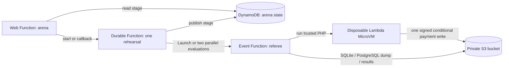

# AWS rehearsal

**One shop, one saved cart, two migrations.** In Launch, deploy the unchanged
PHP/SQLite shop, verify a sale, and leave a cart saved. Terminate the environment.
From the same end-of-Launch checkpoint, rehearse two Growth releases: one that
migrates correctly to PostgreSQL and one that passes `/health` but drops saved
carts. Send the same returning customer through both and show the customer
experience before the conversion, retention and profit consequences. These are
rehearsal forks, not resets available to contestants.

The [local demo](local-play.md) runs the same story with no AWS account and is
the fallback.

## What runs

A real Lambda Web Function serves the arena. It starts a version-pinned Durable
Function, which invokes the Event evaluator for Launch, waits for **Deploy both
migrations**, fans out the two branches, then waits again for **Send the shopper
back**. Keep the execution ARN visible through all three actions. Open the
Launch checkpoint card to show the VM ID and the observed terminal state before
anyone presses Deploy.



The first MicroVM runs PHP/SQLite. The migration MicroVMs each read the same
hashed checkpoint and write a real PostgreSQL dump to S3. The shopper-return
MicroVMs restore those dumps. Each environment finishes and is terminated
before the workflow publishes the stage. PostgreSQL runs inside the disposable
VM; there is no idle RDS instance. This image runs only the trusted rehearsal
code: it has no execution role, but has internet egress for a short-lived,
object-scoped payment PUT. It is **not** a sandbox for arbitrary uploads.

## Prerequisites

AWS CLI, `uv`, Node 24 and `npm`, plus the account and profile from the
[AWS prerequisites](README.md#aws-prerequisites):

```sh
export BLACK_FRIDAY_AWS_ACCOUNT=<12-digit account id>
export BLACK_FRIDAY_AWS_PROFILE=<AWS CLI profile>
aws sso login --profile "$BLACK_FRIDAY_AWS_PROFILE"
```

The rehearsal runs entirely in Sydney (`ap-southeast-2`). It was built and first
run in Oregon, then moved on 23 November 2026, when a full Launch → migrate →
compare run passed in Sydney. Sydney is missing from the
[Web Functions launch post](https://aws.amazon.com/about-aws/whats-new/2026/10/aws-lambda-web-functions/),
but Web Functions run there, and
[MicroVMs are available in Sydney](https://aws.amazon.com/about-aws/whats-new/2026/08/lambda-microvms-5-additional-regions/).

## Deploy and present

```sh
cd demo
uv run aws/operate.py deploy
uv run aws/operate.py present
```

`deploy` checks that the credentials belong to `$BLACK_FRIDAY_AWS_ACCOUNT` in
`ap-southeast-2` before making changes. `deploy --keep-failed` preserves failed stack
resources for diagnosis. It creates project-scoped CloudFormation stacks
`BlackFridayRehearsalArtifacts` and `BlackFridayRehearsal`, then creates or
updates the `black-friday-arena` Web Function through the Lambda Web API.
CloudFormation's `AWS::Lambda::WebFunction` cannot create one any more: since
November 2026 `CreateWebFunction` needs its first revision and endpoint in the
same call. Web Function names are unique across all Regions in an account.
`uv run aws/operate.py package <output>` builds the deployment archives without AWS.

The endpoint requires IAM. `present` runs a loopback proxy (default
<http://127.0.0.1:8767/>, `--port` to change) that signs requests with your
credentials and does not serve the application itself. Close the proxy with
Ctrl-C; that does not stop the durable execution.

Start Launch the night before, within the first callback's 23-hour window. On
stage, restart the proxy if needed, show the same execution ARN, click Deploy,
take the vote, then send Maya back.

Observed: the AWS rehearsal has passed both callbacks through one version-pinned
execution, including real VM termination and S3 ledger checks.

## Costs and caps

- No provisioned EC2, RDS or NAT in the main stack.
- Event evaluator reserved concurrency: 4.
- The network endpoint is IAM-only and rate-limited.
- MicroVM runs have a 120-second hard lifetime.
- The durable run has a 48-hour ceiling.
- Run artifacts and logs expire after seven days; deployment packages remain
  because revisions reference them.

## Teardown

When no run should resume, stop the presenter, then:

```sh
uv run aws/operate.py destroy              # Web Function and its logs, then BlackFridayRehearsal
uv run aws/operate.py destroy --artifacts  # also the artifact bucket (all versions) and its stack
```

`destroy` deletes in the only safe order: the Web Function first, because
CloudFormation does not own it, then the stacks. Without `--artifacts` it keeps
`BlackFridayRehearsalArtifacts` and its bucket together, with the packages and
run evidence; the bucket is never left without the stack that names it. It is
safe to run again after an interrupted teardown.

Managed Instances is not part of this stack. See
[On-demand vs Managed Instances](launch-wave.md#on-demand-vs-managed-instances).
