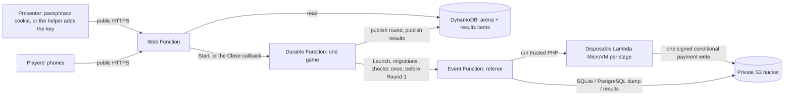

# AWS game and rehearsal

One deployment is live in Sydney (`ap-southeast-2`): **fourround**, the four-round
game. The one-round `round` deployment and the `rehearsal` deployment were
destroyed on 25 November 2026 (their artifacts buckets were kept); redeploy
either from its tag ([the frozen deployments](#the-frozen-deployments)).

| Deployment | What it is | Endpoint | Presenter page | Now |
|:--|:--|:--|:--|:--|
| **fourround** | The four-round game: everyone in the room plays, up to 100 players plus the house, and bots if the room is thin | Public (`ApplicationManaged`): players open it on their phones | <http://127.0.0.1:8770/host> | Deployed. Rollback tag for the 25 November talk: `fourround-live-2026-11-25` |
| **round** | The one-round game it replaced (up to 200 teams, one Growth round) | Public | <http://127.0.0.1:8768/host> | Destroyed; tag `round-fallback-2026-11-25` |
| **rehearsal** | Nobody plays: the presenter compares two releases | IAM only | <http://127.0.0.1:8767/> | Destroyed; tag `rehearsal-fallback-2026-11-24b` |

Select one with `BLACK_FRIDAY_DEPLOYMENT=fourround`, `round` or `rehearsal` (the
default). They share no stacks, functions, tables or Web Function, so one can
change or be torn down without touching the others. `fourround` and `round`
share one thing on purpose: the presenter key and passphrase in SSM, which
outlive every teardown. The [local demo](local-play.md) needs no AWS account and
is the last fallback.

| | Stack | Artifacts stack | Web Function |
|:--|:--|:--|:--|
| fourround | `BlackFridayFourRound` | `BlackFridayFourRoundArtifacts` | `black-friday-four` |
| round | `BlackFridayRound` | `BlackFridayRoundArtifacts` | `black-friday-round` |
| rehearsal | `BlackFridayRehearsal` | `BlackFridayRehearsalArtifacts` | `black-friday-arena` |

**The story.** Four rounds, 13 simulated weeks: Launch (weeks 1–4), Growth
(5–8), Black Friday (9–10), Christmas (11–13). Each player picks one of three
options per round; the profit after the modelled AWS bill decides. The rules,
the economics and the balance check are in [game.md](../game.md). What is
real: after **Start** and before Round 1 opens, a MicroVM runs the unchanged
PHP/SQLite shop and sells a mug, and both growth migrations (careful copies every
table to PostgreSQL, fast omits the carts) are run and each checked in its own
MicroVM. At most five MicroVMs per game (one Launch, two migrations, two
checks); none after that. Everything else is modelled.

## What players do (fourround)

Nobody uploads code. Players only pick; only the organiser's code runs.

1. Scan the QR on the presenter page or slide and open the public URL.
2. **Join**, with a name or without: a blank name becomes a generated
   `Adjective Noun`. The phone keeps a player token; only that phone can change
   the player's name or picks. Tapping an option before joining joins and picks.
   Names can change until the Launch round closes. Joining stays open until the
   Growth round closes; at most 100 audience players.
3. **Pick** one of three big buttons for the open round, and change it as often
   as they like before the round closes. The options come from
   [`rounds.json`](../../demo/aws/rounds.json); `autoscale` is greyed out, and
   refused with 409, unless the player picked Careful or Fast in Growth.
4. Watch the result: their own round (event, sales, slow, failed, cost, profit,
   cumulative, rank, the roll against the risk, and whether the evidence was
   real, recorded or modelled), the top 10 and their own row.

Other players' picks stay hidden. A player who does not pick plays the round's
first option. Bots fill the board up to six players counting the audience and
the house, and are labelled; their names are reserved. A player who joins during
Growth starts from an all-default shop. Joining, renaming and picking are
refused outside those windows and with the wrong token.

## What the presenter does (fourround)

**Sign in on the page itself.** Open `<public URL>/host` on a laptop or phone, no
helper and no Tailscale. The page is public but holds no secret: until you sign
in it shows only a passphrase form. After sign-in it shows the controls, QR,
player list and execution ARN. The cookie is `__Host-bf_host` and lasts 12 hours
(`HttpOnly`, `Secure`, `SameSite=Strict`, `Path=/`, no `Domain`, so a sibling
subdomain cannot set or shadow it); **Sign out** clears it. When the page is
driven through the helper below there is no cookie, so Sign out is hidden.

Set your own passphrase once (at least 8 characters), before the talk:

```sh
cd demo
export BLACK_FRIDAY_AWS_ACCOUNT=<12-digit account id> BLACK_FRIDAY_AWS_PROFILE=<AWS CLI profile>
BLACK_FRIDAY_DEPLOYMENT=fourround uv run aws/operate.py passphrase
```

It asks twice with no echo (or reads one line from stdin when piped), stores it
as the SSM SecureString `/black-friday/round/presenter-passphrase` (shared with
`round`, so changing it changes both), and confirms with the new parameter
version, never the value. Console fallback: Systems Manager → Parameter Store →
`/black-friday/round/presenter-passphrase` → Edit → SecureString value (at least
8 characters). Changing it signs every device out within 30 seconds: each cookie
is an HMAC over its expiry, keyed by the SSM presenter key over the current
passphrase. Until a passphrase exists, sign-in answers 503; presenter routes
accept only the presenter key.

Sign-in is throttled across all of the Web Function's environments: ten failed
attempts in ten minutes, then every sign-in gets 429 until the window passes.
Successful sign-ins do not count. Presenter POSTs also need the
`X-Rehearsal-Action: 1` header, the current run token and, when the browser sends
one, an `Origin` equal to the endpoint's own origin.

**The helper still works, as a second way in.** Either a valid cookie or the
presenter key authorises presenter routes:

```sh
BLACK_FRIDAY_DEPLOYMENT=fourround uv run aws/operate.py present --tailnet
```

`present` reads the presenter key from SSM (`/black-friday/round/presenter-key`)
and runs a loopback proxy at <http://127.0.0.1:8770/host> that adds it to every
request. The key never reaches a browser. (The key is also the MAC secret of the
cookie.) It forwards only the presenter routes below and the page's own files.

`--tailnet` also publishes the presenter page at
`https://<this Mac's MagicDNS name>:8443/host`, so the presenter can drive the
game from a phone on the same tailnet. It runs `tailscale serve` (tailnet only,
not Funnel) in the foreground, so the page disappears when `present` stops; the
Mac must stay awake and online. A second loopback listener (port 8771 for
`fourround`, one above the proxy's port) behind it accepts only requests that
`serve` marks with the Mac owner's login, so another person on the tailnet or a
tagged device gets 403, even where the tailnet policy lets them reach the Mac. A
process on the Mac itself is trusted, as it already is for 8770. Without
`--tailnet`, the page is on the laptop only.

The page shows the public URL as text and a QR code, the players and whether they
have picked for the open round, the round's forecast and market range, the
execution ARN, three action buttons and an **Explanations** on/off toggle (the
callouts that say what each Lambda is doing). **Full screen** under the QR (or a click on the
QR) shows the QR as large as the screen allows, with the public URL in large
text and "Scan. Join. Play.", in browser fullscreen; Esc or a click closes it.

1. **Start.** Only before the game starts. Starts the version-pinned Durable
   execution, which runs the real Launch and both migrations and checks, then
   opens Round 1. Players can join from the moment the game is reset.
2. **Close round N.** Only while a round is open. Freezes every pick, then the
   workflow draws the market, bots and dice, scores the round, publishes its
   results and opens the next round. After Round 4 the game is final and the
   page says to reset. If the close callback's 20-second lease lapses without
   AWS confirming it, the button becomes **Retry close round N**.
3. **Reset.** In any phase: throws every player and score away and starts a fresh
   lobby. The page asks first unless the game is waiting or final. A running
   Durable execution is not stopped; its writes no longer match the new run.

While joining is open each audience player has a **Remove** button (the house
and bots have none): it frees a squatted or rude name, and that phone shows it
was removed and can join again. The server refuses removal while a round is
closing.

Each callback waits at most 23 hours, so click Start less than 23 hours before
the first Close, and keep the gap between Closes under 23 hours.

**Behind the scenes.** Below the controls a drawer, collapsed by default, shows
what the game is doing on AWS. Each line has its time (Adelaide), a coloured tag
(`DURABLE`, `MICROVM` or `WEB`, which you can toggle as filters, beside a search
box) and a short text: Start, the execution registered, the real Launch, the two
migrations and checks (cart kept or lost, VM id), each round opening, Close
(picks frozen), the market draw and bots, the best option and leader, results,
final, and Reset. Recorded evidence, an expired close and Reset are `warn`. While
open it polls `GET /api/host/timeline` every 2 seconds, one request at a time,
never retrying a 429. Clicking a line shows its details and, where the line names
a log group, an **Open logs in CloudWatch** link to that group in the Sydney
console (you need your own console sign-in). The item shape and data model are in
[architecture.md](../architecture.md#the-durable-game-and-its-items).

The pages load `round.js` and `round.css` as `?v=<content hash>`, so a browser
that cached the old script for its hour never runs it against a new page after
a redeploy.

### Live log for the room (fourround)

A separate, presenter-only Web Function, `black-friday-four-logs`, streams the
game's log from AWS. It needs no laptop, tunnel or SSO session:

```sh
cd demo
BLACK_FRIDAY_DEPLOYMENT=fourround uv run aws/operate.py deploy-logs    # prints LogsUrl
BLACK_FRIDAY_DEPLOYMENT=fourround uv run aws/operate.py destroy-logs   # its function, log groups, stack and bucket
```

`deploy-logs` deploys only the stack `BlackFridayFourRoundLogs`, which holds a
read-only `LogsRole` and the bucket for the logs package, and then the function.
It reads the game stack's outputs but never changes the game's stacks,
functions or bucket policy.

Only the sign-in page and its own script and stylesheet are public. Sign in with
the presenter passphrase; the same `__Host-bf_host` cookie rules apply, on this
function's own origin, with an in-memory throttle. The viewer (`/viewer`), its
assets and every data route (`/stream`, `/events`, `/api/status`) need the
cookie or the presenter key. Signed out they answer 403, or 303 to sign-in for
the viewer page.

Each environment runs one shared poller while someone is watching, so more
viewers never mean more AWS reads. It reads the arena and timeline items and
the current execution's Durable history every 2 s, and CloudWatch through one
Live Tail session. FilterLogEvents fills the last 15 minutes on connect and any
gaps every 10 s.

Every line has one of eight tags, a level (`debug`, `info`, `warn` or `error`;
an error is a level, never a tag) and the structured formats in
[architecture.md](../architecture.md#log-lines). Filter errors with the `error`
level.

| Tag | Source |
|:--|:--|
| `DURABLE` | The execution's history: each operation once (steps, invokes, the parallel migrations and checks, callbacks waiting and Closes received), with elapsed time, and each suspension between invocations; plus the workflow's decisions from the timeline item (registered, round open, Close received, plan, score, results, final, recorded evidence as `warn`). |
| `WORKFLOW` | `[WORKFLOW]` lines: one per Durable step (market draw, bots, best option, leader's total) and each invocation's duration. |
| `EVENT` | `[EVENT]` lines from the Event judge: VM requested, endpoint ready, setup sent, each shop check with status and ms, artifact saved, VM terminated; plus its duration and cold start. |
| `MICROVM` | The summary of a stage that really ran in a VM: Launch, careful and fast, once the workflow publishes them. Recorded evidence is never `MICROVM`. |
| `VM` | `[VM]` stage entries inside each VM: setup received, initdb, PostgreSQL start, `migrate.php` or `pg_restore`, PHP shop ready, Maya's saved cart, artifact exported, shutdown. |
| `PHP` | `[VM]` entries of kind `php`: one per shop request (`GET /cart/cart-saved 404 3 ms`). |
| `WEB` | The game Web Function: one access line per request (route template, status, ms, phase and round; polls are `debug`), and each minute `environment served N requests` with its peak concurrency. Its `console.error` lines are free text. |
| `WATCH` | The viewer's own warnings, e.g. `live tail unavailable: …`. Only the logs function emits it. |

The arena item feeds no log line: it gives the status bar its player and pick
counts, and Story its cards.

**VM logs reach CloudWatch through the judge.** RunMicrovm refuses CloudWatch
logging without an `executionRoleArn`, and the VM keeps no AWS role, so runs use
`logging={disabled}`. `vm_runtime.py` keeps its last 500 entries in memory; the
evaluator reads them from `GET /control/log` before it terminates the VM (also
after a failure) and prints each unchanged as `[VM] <json>` in its own log
group. No entry carries a payment URL, receipt, token or full run id, and the
evaluator drops an entry that is not valid.

Measured in a 5-player game on 25 November 2026 (04:26 UTC), from the event's
own timestamp to arrival in the browser stream:

| Tag | Median | Max |
|:--|--:|--:|
| DURABLE | 1.0 s | 2.1 s |
| MICROVM (evidence summary) | 0.4 s | 0.4 s |
| WORKFLOW | 8.6 s | 10.3 s |
| EVENT, VM, PHP | 9–10 s | 10.5 s |
| WEB | 25 s | 35 s, one at 114 s |

The CloudWatch delay is the log pipeline's own: a bare Live Tail session from a
laptop showed the game Web Function's lines 8–35 s after their timestamps.
Durable lines come straight from the history API.

`GET /stream` is Server-Sent Events and streams unbuffered. Each connection
lasts up to the 900-second timeout, then the browser reconnects with
`Last-Event-ID`. The server re-sends from 60 s before that cursor, and the page
drops duplicates by event id, so a reconnect leaves no gap and no duplicate. If
no `hello` arrives within 5 s the page polls `/events` every 2 s instead.
In the browser you can toggle tags and levels (`debug` is hidden by default),
search (optionally with a regex), pause, and expand a line. Filters live in the
URL hash, and the page keeps 10,000 lines.

**Story and Follow.** **Story** turns the viewer into a projector card that says
in plain words what the system is doing now (lobby, Start, Launch, migrations,
checks, round open, Close, final), with a trail of earlier cards below. The
server builds the cards from the fast sources only: the arena item, Durable
history, the timeline and the results items. Every number on a card comes from
one of those events, and a phrase is left out when its number is unknown. The
VM, PHP and EVENT lines from CloudWatch arrive about 10 s later and fold in
under the card for their stage. **Follow** picks a player by display name
(`/api/players`, presenter-only, never a token hash). Their joins, renames and
picks come from diffing the roster each poll, and their row in each round's
results (roll against risk, rank, running total, real or modelled) adds a line
to the matching card. With Follow on, the stage detail shows only the
migration that player picked. Both settings live in the URL hash.

## What runs



The first MicroVM runs PHP/SQLite. Each migration MicroVM reads the same hashed
checkpoint and writes a real PostgreSQL dump to S3; each check MicroVM restores
that dump and asks whether the saved cart survived. Every environment finishes
and is terminated before the workflow opens Round 1. The four rounds then run
inside the workflow as the pure functions in `model.py`; no MicroVM exists after
Round 1 opens. PostgreSQL runs inside the disposable VM; there is no idle RDS
instance. The image runs only trusted organiser code: it has no execution role,
but has internet egress for a short-lived, object-scoped payment PUT. It is
**not** a sandbox for arbitrary uploads. The Durable sequence and the DynamoDB
items are in [architecture.md](../architecture.md#the-durable-game-and-its-items).

Public routes: `GET /`, `/host` (the page only), `/round.js`, `/round.css`
(cached for an hour, like the hero image), `/art/cloud-surge.jpg`, `/api/state`;
`POST /api/join` (`{name?}`), `/api/rename` (`{id, token, name}`), `/api/pick`
(`{id, token, round, option}`), `/api/host/login`, `/api/host/logout`. A phone
sends its `X-Team-Id` and `X-Team-Token` headers with `/api/state` to learn its
own name and picks. Presenter routes, all under `/api/host/` (a valid cookie or
the presenter key, otherwise 403): `GET /api/host/state`, `/api/host/qr.svg`, `/api/host/timeline`;
`POST /api/host/start`, `/api/host/close` (also needs `X-Rehearsal-Round: <round>`),
`/api/host/reset` (these three take no body) and `/api/host/remove` (a JSON body
of at most 2 KiB: the player id). Anything else is 404; the old
`/api/launch`, `/api/migrate` and `/api/compare` routes exist only in the frozen
deployments. Only presenter routes start compute. API responses are `no-store`;
every response carries `Strict-Transport-Security`. The public URL and the origin
check come only from the deployed `PUBLIC_HOST`, never from request headers;
without it they fail closed. A stored passphrase shorter than 8 characters counts
as unset (503).

Refusals are 409 (not allowed now: a closed round, a locked name, a taken name,
a full game, `autoscale` without a shared database) or 400 (not a valid name or
option) or 403 (wrong player token).

Close is one atomic write: it moves the phase from `open` to `closing` for this
run, callback and round, and copies the roster at that instant into
`frozen_data`, which the Durable callback carries. A pick that races it either
committed first (it counts) or is refused ("That round is closed"); a Close for
the wrong round or a stale callback is refused; a retry of an unconfirmed
callback re-sends the same frozen roster. Every roster write (join, rename, pick,
remove) is a conditional write that fails if the roster changed since it was
read, so a room joining at once retries with a short jitter.

Phones poll `/api/state` every 3 s plus 0–1 s of jitter, never overlap polls and
never retry a throttled poll; after `final`, `expired` or `failed` the presenter
polls every 15 s and phones every 30 s, so a Reset is still noticed. A results
item never changes once written, so the Web Function caches it for good.

## Prerequisites

AWS CLI, `uv`, Node 24 and `npm`, plus the account and profile from the
[AWS prerequisites](README.md#aws-prerequisites):

```sh
export BLACK_FRIDAY_AWS_ACCOUNT=<12-digit account id>
export BLACK_FRIDAY_AWS_PROFILE=<AWS CLI profile>
aws sso login --profile "$BLACK_FRIDAY_AWS_PROFILE"
```

The first deployments were built and run in Oregon, then moved to Sydney on
23 November 2026. Sydney is missing from the
[Web Functions launch post](https://aws.amazon.com/about-aws/whats-new/2026/10/aws-lambda-web-functions/),
but Web Functions run there, and
[MicroVMs are available in Sydney](https://aws.amazon.com/about-aws/whats-new/2026/08/lambda-microvms-5-additional-regions/).

## Deploy

```sh
cd demo
BLACK_FRIDAY_DEPLOYMENT=fourround uv run aws/operate.py deploy
```

`deploy` checks that the credentials belong to `$BLACK_FRIDAY_AWS_ACCOUNT` in
`ap-southeast-2` before making changes; `--keep-failed` preserves failed stack
resources for diagnosis. It creates the stacks `BlackFridayFourRoundArtifacts`
and `BlackFridayFourRound`, creates the presenter key in SSM once (it is shared
with `round`), then creates or updates the `black-friday-four` Web Function
through the Lambda Web API. The workflow package holds `workflow.py`, `model.py`
and `rounds.json`; the worker is `evaluator.py`; the web package holds
`game.mjs`, `host_auth.mjs`, `roster.mjs`, `rounds.json`, the pages and the art.
CloudFormation's `AWS::Lambda::WebFunction` cannot create one any more: since
November 2026 `CreateWebFunction` needs its first revision and endpoint in the
same call. Web Function names are unique across all Regions in an account.
`uv run aws/operate.py package <output>` builds the deployment archives without
AWS. For a change to the pages or the game Web Function's code alone,
`BLACK_FRIDAY_DEPLOYMENT=fourround uv run aws/operate.py deploy-web` builds and
uploads only the web package and creates a new revision of `black-friday-four`.
It makes no stack change, so the workflow, evaluator and image keep their
versions.

### The frozen deployments

Both were destroyed on 25 November 2026, artifacts buckets kept. On this branch
`deploy` refuses `round` and `rehearsal`. To bring either back, deploy it from
its tag with `git archive`, and present it from either checkout:

```sh
out=$(mktemp -d) && git archive round-fallback-2026-11-25 | tar -x -C "$out"
cd "$out/demo" && BLACK_FRIDAY_DEPLOYMENT=round uv run aws/operate.py deploy
BLACK_FRIDAY_DEPLOYMENT=round uv run aws/operate.py present    # http://127.0.0.1:8768/host
```

```sh
out=$(mktemp -d) && git archive rehearsal-fallback-2026-11-24b | tar -x -C "$out"
cd "$out/demo" && uv run aws/operate.py deploy
uv run aws/operate.py present    # from any checkout: signs requests, http://127.0.0.1:8767/
```

The one-round game's rules and runbook are in its own tag's copy of this file.

## Costs and caps

- No provisioned EC2, RDS or NAT in any deployment.
- fourround: at most five MicroVMs per game, all before Round 1 opens; Event
  evaluator reserved concurrency 10 (rehearsal: 4). Everything after is
  arithmetic in the workflow.
- The public endpoint scales to at most 10 environments, 100 requests/s, 8
  concurrent requests per environment, 15 s timeout, and accepts small JSON
  bodies; the public can join, rename and pick but never start a run or a
  MicroVM.
- At most 100 audience players keep the arena item (the roster and its frozen
  copy) and each results item small against DynamoDB's 400 KB item limit; the
  go/no-go run checks the largest item.
- MicroVM runs have a 120-second hard lifetime.
- A Durable run has a 48-hour ceiling; each callback waits at most 23 hours.
- Run artifacts and logs expire after seven days; deployment packages remain
  because revisions reference them.

## Teardown

When no run should resume, stop the presenter, then, for one deployment:

```sh
BLACK_FRIDAY_DEPLOYMENT=fourround uv run aws/operate.py destroy-logs         # the live log first: its function, log groups, stack and bucket
BLACK_FRIDAY_DEPLOYMENT=fourround uv run aws/operate.py destroy              # Web Function and its logs, then BlackFridayFourRound
BLACK_FRIDAY_DEPLOYMENT=fourround uv run aws/operate.py destroy --artifacts  # also its artifact bucket (all versions) and stack
```

Use `BLACK_FRIDAY_DEPLOYMENT=round` or `rehearsal` (the default) for the others.
`destroy` deletes in the only safe order: the Web Function first, because
CloudFormation does not own it, then the stacks. It deletes only the game
function's own log groups (`web_log_groups` matches the exact name or a child of
it); `black-friday-four-logs` has a name that starts the same way, and `destroy`
no longer removes its log group (it did before 25 November 2026). It still never
removes the logs function, stack or bucket, so run `destroy-logs` for those.
Without `--artifacts` it keeps the artifacts stack and its bucket, with the
packages and run evidence. With it, the stack goes before the bucket it retains,
then the bucket is found by name and emptied, so a re-run finishes an
interrupted teardown. It never touches the other deployments. The presenter key
and passphrase stay in SSM, shared by `round` and `fourround` (`aws ssm
delete-parameter --name /black-friday/round/presenter-passphrase` removes the
passphrase; the sign-in then answers 503).

Managed Instances is not part of any deployment. See
[On-demand vs Managed Instances](launch-wave.md#on-demand-vs-managed-instances).

## Go/no-go measurements

Recorded 25 November 2026, 02:38–02:43 UTC, against `fourround` in Sydney
(first deploy took 5 min 40 s). A throwaway script drove the public endpoint
like phones from one host: 98 players joining over 10 s (a third with blank
names, a third with 20-character emoji names), two late joiners in Growth, one
player who never picks, every phone polling `/api/state` every 3 s + 0–1 s, each
round's picks spread over 8 s with a third changing their minds, one pick racing
each Close, wrong-round and `autoscale`-after-`stay` picks (all refused with 409).
The presenter routes were driven with the SSM presenter key. Two full games,
then a game Reset mid-Growth, then a fresh full game:

| Check | Pass mark | Measured |
|:--|:--|:--|
| Presenter errors | 0 | 0 |
| Phone 5xx and 429 | < 1% | 5 × 429 in 8,651 requests (0.06%), all polls; no 5xx |
| Start → Round 1 open (real Launch, two migrations, two checks) | — | 24.8–26.0 s |
| Close → results on `/api/state` | p95 ≤ 5 s | median 0.61 s, p95 0.88 s (watcher polling every 0.25 s; a phone adds up to one 3–4 s poll) |
| Largest DynamoDB item | < 200 KB | 46.9 KB (the arena item while a round is closing) |
| Every row's `cumulative_cents` vs an offline `model.score` replay of the checkpointed `plan-<round>` results | equal | 3 games × 402 rows, 0 mismatches |

In the three completed games both migrations' evidence was `real`: careful kept
Maya's cart (200), fast lost it (404), as expected. The two executions left
waiting by the Resets were stopped afterwards.

**Second run, the build with the timeline and logs (commit 928bc61), 03:46–03:50
UTC.** It used the same script and the same games, and also checked the
timeline. Every evidence source was `real` in all three completed games.

| Check | Pass mark | Measured |
|:--|:--|:--|
| Presenter errors | 0 | 0 |
| Phone 5xx and 429 | < 1% | 0 in 8,509 requests |
| Start → Round 1 open | — | 22.8–25.6 s |
| Close → results on `/api/state` | p95 ≤ 2 s | median 0.58 s, p95 0.85 s |
| Largest DynamoDB item | < 200 KB | 47.0 KB (arena) |
| `cumulative_cents` vs offline replay | equal | 3 games × 402 rows, 0 mismatches |
| Timeline: every expected line once per game, nothing secret | exact | 33 lines per game, 0 missing, duplicated or extra, 0 secret-looking details |
| `/api/host/timeline` without sign-in | 403 | 403 |

Before this run, one 5-player game's logs in all four `fourround` log groups were
searched for `php:`, `receipt`, `token`, `pay_url`, `X-Amz-`, `Signature`,
`cookie`, the passphrase and the presenter key. The only hit was the apt
package name `tokenizer.ini` in the image build log.

**Third run, the structured-log build presented at the talk (commit 7d76481),
06:27–06:31 UTC.** One 5-player game, then one 100-phone game with the same
script. Launch, careful and fast evidence was `real` in both.

| Check | Pass mark | Measured |
|:--|:--|:--|
| Presenter errors | 0 | 0 |
| Phone 5xx and 429 | < 1% | 0 in 2,300 requests (5 × 409, the deliberate refusals) |
| Start → Round 1 open | — | 22.9 s |
| Close → results on `/api/state` | p95 ≤ 2 s | 0.33–0.84 s, p95 0.84 s |
| Live viewer, 5-player game | every source present, nothing dropped | VM 41, PHP 28, EVENT 54, WORKFLOW 29, DURABLE 52, MICROVM 5; 0 contract-dropped lines; Story one card per stage, one run |

Not run: a forced stage failure. The harness has no injection hook, so the
recorded-evidence fallback is covered by unit tests only.

The game was then played live at the AWS User Group Adelaide talk on 25 November
2026: 28 players to the final board.
